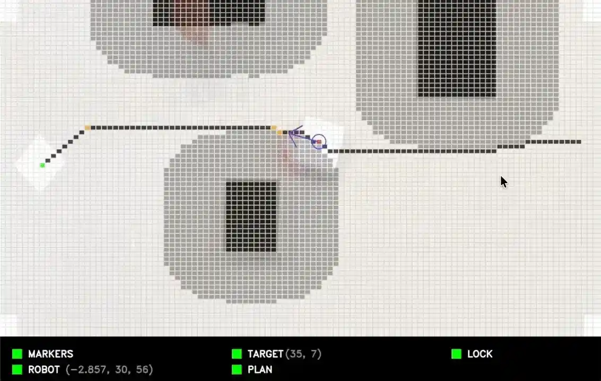
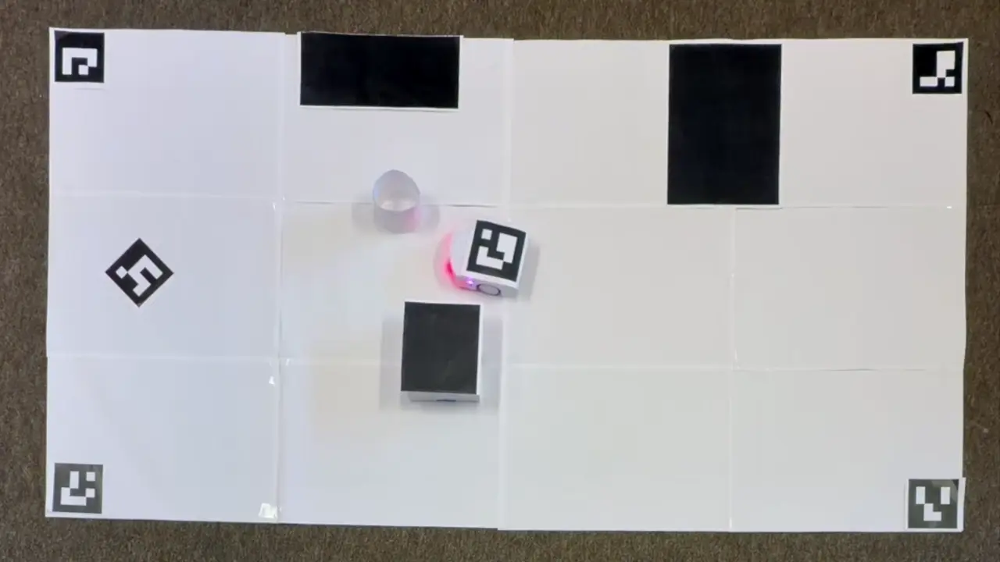

# The Thymio escape

For our 2025 fall semester project for the _Basics of mobile robotics_ course at EPFL, we chose to save Thymio from its world. To escape, the robot needs to join the portal as soon as possible and avoid any obstacles in his way.

> 📓 **How does Thymio find its way out?** The [project report](Group_T24_report.ipynb) takes it apart piece by piece: ArUco vision, A\* path planning, local obstacle avoidance and Kalman filtering, with the figures and tuning behind each choice.

| EPFL                                     | Full name                          |
|:-----------------------------------------|:-----------------------------------|
| [341237](https://people.epfl.ch/341237)  | Louis Grange                       |
| [362819](https://people.epfl.ch/362819)  | Alessandro De Zen                  |
| [328691](https://people.epfl.ch/328691)  | Verter Stoilov                     |

| Project GUI                                     | External top view                     |
|:-----------------------------------------|:-----------------------------------|
|   |                        |

## ⚙️ Quickstart

1. Clone the repository
2. Open a terminal and execute `python -m venv /PATH/TO/PROJECT/.venv` to create a virtual environment
3. Activate the environment using `source /PATH/TO/PROJECT/.venv/bin/activate`
4. Execute `pip install -r requirements.txt` to install the project dependencies
5. Launch the main file using `python3 /PATH/TO/PROJECT/main.py`
